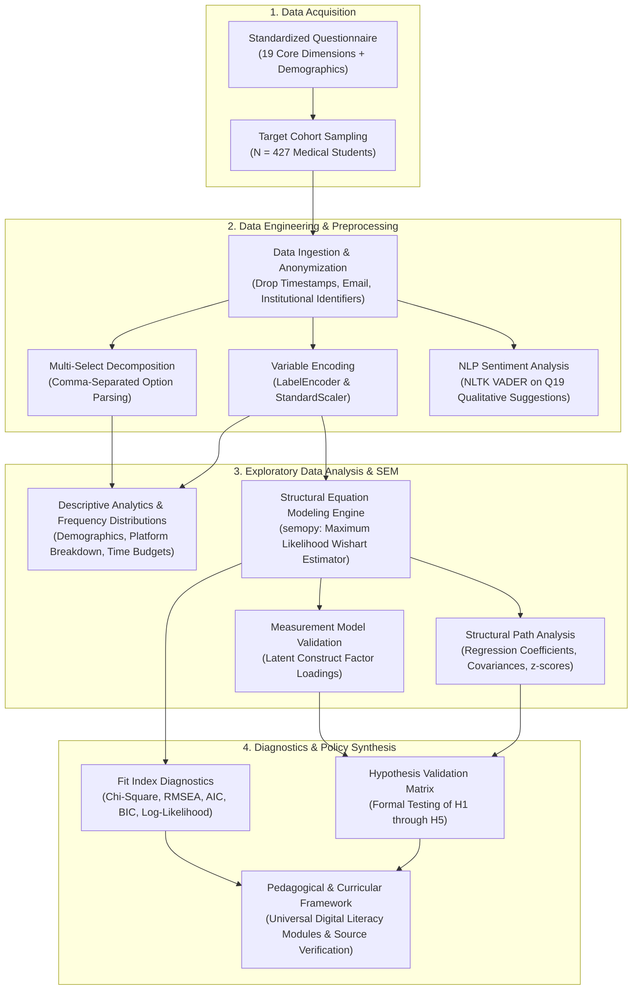
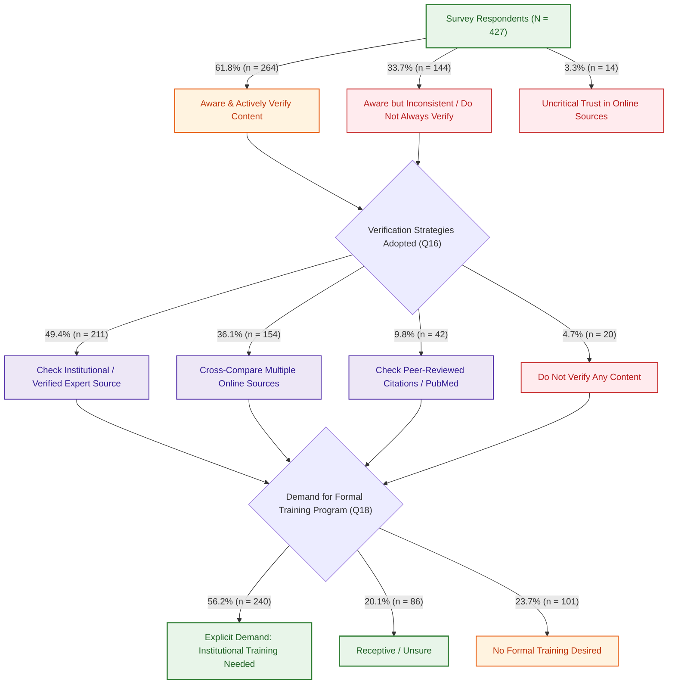
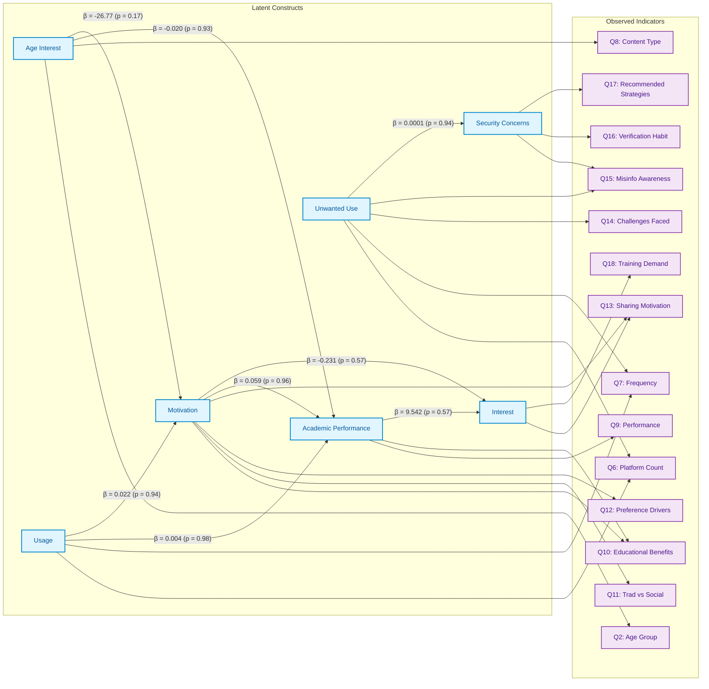
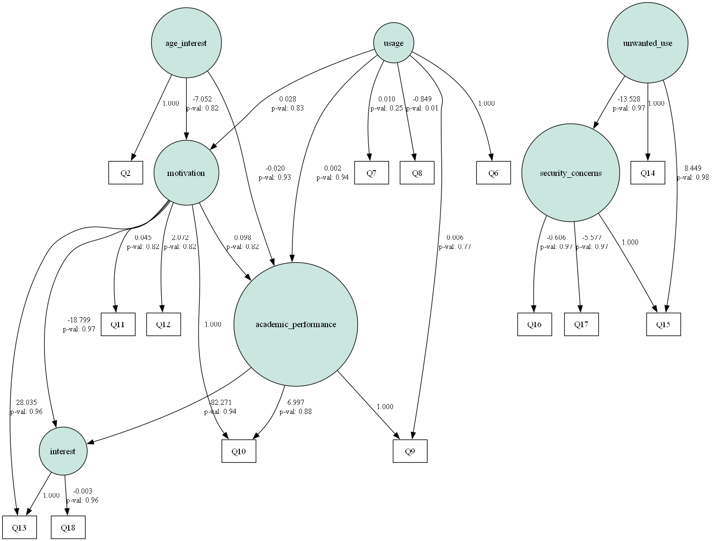

# 📘 Understanding Social Media Use Among Medical Students: An Exploratory Structural Equation Modeling (SEM) Study

[](https://www.python.org/)
[](https://jupyter.org/)
[-brightgreen)](#-structural-equation-modeling-sem-framework)
[](https://semopy.com/)
[](#-survey-demographics--cohort-profile)
[](#-license--citation)

---

## 📑 Table of Contents
1. [📖 Executive Summary & Overview](#-executive-summary--overview)
2. [🎯 Research Objectives & Hypotheses](#-research-objectives--hypotheses)
3. [🔬 Research Methodology & Analytics Pipeline](#-research-methodology--analytics-pipeline)
4. [👥 Survey Demographics & Cohort Profile ($N = 427$)](#-survey-demographics--cohort-profile-n--427)
5. [📊 Empirical Findings & Usage Patterns](#-empirical-findings--usage-patterns)
6. [🛡️ Information Disorders & Verification Behaviors](#️-information-disorders--verification-behaviors)
7. [📐 Structural Equation Modeling (SEM) Framework](#-structural-equation-modeling-sem-framework)
   - [Conceptual & Path Architecture](#conceptual--path-architecture)
   - [SEM Path Diagram (`sem_model.png`)](#sem-path-diagram-sem_modelpng)
   - [Parameter Estimates & Factor Loadings](#parameter-estimates--factor-loadings)
   - [Goodness-of-Fit Diagnostics](#goodness-of-fit-diagnostics)
   - [Alternative Latent Formulation](#alternative-latent-formulation)
8. [🧪 Hypotheses Testing Results Matrix](#-hypotheses-testing-results-matrix)
9. [💬 Qualitative Feedback & NLP Sentiment Analysis](#-qualitative-feedback--nlp-sentiment-analysis)
10. [💡 Strategic Implications & Pedagogical Recommendations](#-strategic-implications--pedagogical-recommendations)
11. [📂 Repository Architecture & File Directory](#-repository-architecture--file-directory)
12. [🚀 Installation, Setup & Reproduction Guide](#-installation-setup--reproduction-guide)
13. [📄 Citation & Academic Attribution](#-citation--academic-attribution)

---

## 📖 Executive Summary & Overview

In modern healthcare education, digital platforms and social media ecosystems have increasingly supplemented or supplanted traditional pedagogy. This repository houses the complete empirical dataset, analytical pipelines, exploratory structural equation models, and diagnostic reports for the study: **"Understanding the Use of Social Media by Medical Students: An Exploratory Study"**.

The research investigates how undergraduate, postgraduate, and clinical medical students leverage social networks for academic development, peer collaboration, and knowledge retrieval. Crucially, the study evaluates the dual-edged reality of social media in medical education:
* **Academic Enablers:** Rapid access to high-yield lecture videos, global expert communities, clinical case discussions, and exam preparation.
* **Inherent Hazards:** Cognitive distraction, excessive non-academic screen time, reliance on unverified digital shortcuts over standard textbooks, and vulnerability to **medical misinformation/disinformation**.

Based on an empirical survey of **$N = 427$ medical trainees**, this project applies **Exploratory Structural Equation Modeling (SEM)** using [`semopy`](https://semopy.com/), alongside descriptive cross-tabulations and **Natural Language Processing (NLTK VADER)** sentiment scoring on qualitative feedback, delivering actionable insights for medical curriculum reform.

---

## 🎯 Research Objectives & Hypotheses

### Primary Research Objectives
1. **Platform Investigation:** Map the adoption and penetration of diverse social media platforms (YouTube, WhatsApp, LinkedIn, Instagram, Online Medical Forums, etc.) for academic learning.
2. **Academic Impact:** Evaluate student perceptions of how digital channels enhance exam performance and comprehension of complex clinical topics.
3. **Behavioral Motivations:** Identify the primary drivers behind information sharing, peer-teaching, and academic reinforcement in digital spaces.
4. **Digital vs. Traditional Modalities:** Determine why medical students increasingly favor social channels over traditional pedagogical resources (textbooks, institutional library archives, didactic lectures).
5. **Information Disorder Awareness:** Gauge awareness levels, critical appraisal skills, and detection strategies regarding medical misinformation and fraudulent health claims.
6. **Information Harvesting:** Formulate structured strategies to harvest high-yield clinical data efficiently without succumbing to algorithmic distraction.
7. **Institutional Support & Verification Systems:** Design mechanisms and institutional frameworks to guide medical students toward peer-reviewed, evidence-based digital resources.

---

## 🔬 Research Methodology & Analytics Pipeline

The end-to-end analytical workflow integrates questionnaire instrumentation, multi-scale preprocessing, sentiment extraction, and structural equation modeling.



---

## 👥 Survey Demographics & Cohort Profile ($N = 427$)

The study surveyed **427 valid respondents** across diverse medical institutions, qualification levels, and training stages:

| Demographic Metric | Sub-Category | Frequency ($n$) | Percentage (%) | Visual Distribution |
| :--- | :--- | :---: | :---: | :--- |
| **Gender** | Male | 320 | 74.9% | `███████████████░░░░` |
| | Female | 106 | 24.8% | `█████░░░░░░░░░░░░░░` |
| | Other / Unspecified | 1 | 0.2% | `░░░░░░░░░░░░░░░░░░░` |
| **Age Group** | 18 – 23 Years | 378 | 88.5% | `██████████████████░` |
| | 24 – 29 Years | 38 | 8.9% | `██░░░░░░░░░░░░░░░░░` |
| | 30 – 35 Years | 7 | 1.6% | `░░░░░░░░░░░░░░░░░░░` |
| | 35+ Years | 4 | 0.9% | `░░░░░░░░░░░░░░░░░░░` |
| **Qualification** | Under-graduate (MBBS) | 371 | 86.9% | `█████████████████░░` |
| | Post-graduate (MD/MS) | 42 | 9.8% | `██░░░░░░░░░░░░░░░░░` |
| | Research Scholar | 11 | 2.6% | `░░░░░░░░░░░░░░░░░░░` |
| | Other / Allied Health | 3 | 0.7% | `░░░░░░░░░░░░░░░░░░░` |
| **Professional Year** | Fourth Year | 165 | 38.6% | `████████░░░░░░░░░░░` |
| | Second Year | 115 | 26.9% | `█████░░░░░░░░░░░░░░` |
| | Third Year | 91 | 21.3% | `████░░░░░░░░░░░░░░░` |
| | First Year | 56 | 13.1% | `██░░░░░░░░░░░░░░░░░` |
| **Digital Literacy** | Intermediate | 260 | 60.9% | `████████████░░░░░░░` |
| | Advanced | 105 | 24.6% | `█████░░░░░░░░░░░░░░` |
| | Beginner | 62 | 14.5% | `███░░░░░░░░░░░░░░░░` |

---

## 📊 Empirical Findings & Usage Patterns

### 1. Platform Adoption for Academic Purposes (Q6)
Medical students utilize multiple digital ecosystems concurrently, with audiovisual and messaging tools taking precedence:

```
YouTube        [331 / 77.5%]  ███████████████████████████████████████
WhatsApp       [243 / 56.9%]  ████████████████████████████
LinkedIn       [240 / 56.2%]  ████████████████████████████
Instagram      [190 / 44.5%]  ██████████████████████
Online Forums  [ 83 / 19.4%]  ██████████
Academic Blogs [ 76 / 17.8%]  █████████
Facebook       [ 75 / 17.6%]  █████████
```

### 2. Daily Academic Time Budget on Social Media (Q7)
* **1 – 2 Hours:** 31.9% ($n = 136$)
* **2 – 3 Hours:** 31.9% ($n = 136$)
* **3 – 4 Hours:** 18.7% ($n = 80$)
* **> 4 Hours:** 17.6% ($n = 75$)
> **Key Insight:** Over **68.2%** of medical students spend **2 or more hours daily** on social media exclusively for academic purposes.

### 3. Primary Academic Content Accessed (Q8)
* **Lecture Videos & Demonstrations:** 81.7% ($n = 349$)
* **Exam Preparation & High-Yield Summaries:** 62.5% ($n = 267$)
* **Research Articles & Scientific Journals:** 41.0% ($n = 175$)
* **Online Study Groups & Peer Circles:** 32.6% ($n = 139$)
* **Medical Case Discussions:** 28.3% ($n = 121$)
* **Medical Diagnostic Quizzes:** 18.3% ($n = 78$)

### 4. Perceived Academic Utility vs. Traditional Pedagogy (Q9 & Q11)
* **Academic Performance Improvement (Q9):**
  * **84.8% ($n = 362$)** affirm that social media directly improves their academic performance.
  * 8.4% ($n = 36$) are unsure; only 6.8% ($n = 29$) report no perceived benefit.
* **Effectiveness Compared to Books & Lectures (Q11):**
  * **60.2%** find social media more effective than traditional lectures and textbooks (27.9% Strongly Agree + 32.3% Agree).
  * 33.5% maintain a neutral stance; only 6.3% disagree.

### 5. Why Students Prefer Social Media Over Traditional Sources (Q12)
1. **Speed & Timeliness:** Quick, regularly updated clinical data (**59.7%**, $n = 255$).
2. **Ubiquitous Convenience:** On-demand access 24/7 (**58.3%**, $n = 249$).
3. **Engagement:** Interactive audiovisual content (**46.6%**, $n = 199$).
4. **Global Expert Access:** Direct learning from international specialists (**41.7%**, $n = 178$).
5. **Peer Networking:** Seamless collaboration across cohorts (**23.7%**, $n = 101$).

### 6. Primary Obstacles & Vulnerabilities (Q14)
* **Distraction from non-academic content:** 51.5% ($n = 220$)
* **Misinformation & fake medical content:** 49.9% ($n = 213$)
* **Privacy & digital security concerns:** 37.0% ($n = 158$)
* **Over-reliance on social media over standard textbooks:** 32.8% ($n = 140$)
* **Lack of time to verify digital sources:** 24.4% ($n = 104$)

---

## 🛡️ Information Disorders & Verification Behaviors

A critical pillar of the study was assessing how future clinicians navigate medical infodemics and evaluate content veracity.



> [!WARNING]
> While **61.8%** report actively verifying information, **less than 10% (9.8%) consult peer-reviewed scientific literature** when cross-examining social media claims. Nearly **37%** either do not consistently verify or blindly trust digital posts, posing a major risk of propagating clinical misconceptions.

---

## 📐 Structural Equation Modeling (SEM) Framework

### Conceptual & Path Architecture

The exploratory SEM model tests structural dependencies between demographic indicators, usage intensity, academic performance, motivations, and security concerns.



### SEM Path Diagram (`sem_model.png`)

Below is the full graphical path diagram rendered directly from the structural model via Graphviz and `semopy.semplot`:



*Figure: Full structural equation path diagram with standardized regression estimates and p-values.*

---

### Parameter Estimates & Factor Loadings

The model was estimated using the **Maximum Likelihood Wishart (`MLW`)** objective with **Sequential Least Squares Programming (`SLSQP`)** in `semopy` (391 iterations, converged successfully):

#### Structural Regressions
| Endogenous Variable | Path | Exogenous Variable | Estimate ($\beta$) | Std. Err | $z$-value | $p$-value | Significance |
| :--- | :---: | :--- | :---: | :---: | :---: | :---: | :---: |
| `academic_perf` | $\leftarrow$ | `usage` | 0.0036 | 0.1333 | 0.0267 | 0.9787 | Not Significant |
| `academic_perf` | $\leftarrow$ | `motivation` | 0.0592 | 1.2281 | 0.0482 | 0.9615 | Not Significant |
| `academic_perf` | $\leftarrow$ | `interest` | -1.1918 | 45.0445 | -0.0265 | 0.9789 | Not Significant |
| `interest` | $\leftarrow$ | `motivation` | -0.2309 | 0.4106 | -0.5623 | 0.5739 | Not Significant |
| `interest` | $\leftarrow$ | `academic_perf` | 9.5418 | 16.9125 | 0.5642 | 0.5726 | Not Significant |
| `security` | $\leftarrow$ | `unwanted_use` | 0.0001 | 0.0018 | 0.0738 | 0.9412 | Not Significant |
| `motivation` | $\leftarrow$ | `age_interest` | -26.7688 | 19.5505 | -1.3692 | 0.1709 | Not Significant |
| `motivation` | $\leftarrow$ | `usage` | 0.0225 | 0.3010 | 0.0747 | 0.9405 | Not Significant |

#### Measurement Model (Factor Loadings)
| Latent Construct | Indicator | Observed Question Meaning | Loading ($\lambda$) | Std. Err | $p$-value |
| :--- | :---: | :--- | :---: | :---: | :---: |
| `age_interest` | `Q2` | Age Group | 1.0000 | Baseline | — |
| `age_interest` | `Q8` | Type of Academic Content | -7.7042 | 9.2243 | 0.4036 |
| `usage` | `Q6` | Social Media Platforms Count | 1.0000 | Baseline | — |
| `usage` | `Q7` | Daily Usage Frequency | 0.0100 | 0.1318 | 0.9393 |
| `academic_perf` | `Q9` | Improves Academic Performance | 1.0000 | Baseline | — |
| `academic_perf` | `Q10` | Educational Benefits | -21.0469 | 16.7569 | 0.2091 |
| `motivation` | `Q10` | Educational Benefits | 1.0000 | Baseline | — |
| `motivation` | `Q11` | Effectiveness vs Traditional | 0.0037 | 0.0127 | 0.7718 |
| `motivation` | `Q12` | Reason for Preference | 0.6597 | 0.3534 | **0.0620** |
| `motivation` | `Q13` | Motivation for Sharing Content | 0.1876 | 0.0966 | **0.0520** |
| `interest` | `Q13` | Motivation for Sharing Content | 1.0000 | Baseline | — |
| `interest` | `Q18` | Training Program Interest | 0.8045 | 0.8046 | 0.3174 |
| `unwanted_use` | `Q6` | Platform Count | 1.0000 | Baseline | — |
| `unwanted_use` | `Q7` | Daily Usage Frequency | 0.0106 | 0.1405 | 0.9399 |
| `unwanted_use` | `Q14` | Challenges & Distraction | -0.0090 | 0.1197 | 0.9400 |
| `unwanted_use` | `Q15` | Misinformation Awareness | 0.0021 | 0.0275 | 0.9398 |
| `security` | `Q15` | Misinformation Awareness | 1.0000 | Baseline | — |
| `security` | `Q16` | Credibility Verification Habit | -27.5431 | 71.0410 | 0.6982 |
| `security` | `Q17` | Strategies for Effective Use | -30.0846 | 40.8310 | 0.4612 |

---

### Goodness-of-Fit Diagnostics

| Fit Metric | Model Value | Baseline / Recommended Threshold | Evaluation |
| :--- | :---: | :---: | :--- |
| **Chi-Square ($\chi^2$)** | 156.032 | Baseline $\chi^2 = 275.487$ ($p < 0.001$) | Statistically Significant |
| **Degrees of Freedom ($df$)** | 61 | Baseline $df = 91$ | Valid over-identified model |
| **RMSEA** | **0.060** | $< 0.06$ (Good), $\le 0.08$ (Acceptable) | ✅ **Acceptable Fit** |
| **Akaike Information Criterion (AIC)** | 87.269 | Lower is better | Highly parsimonious |
| **Bayesian Information Criterion (BIC)** | 265.768 | Penalizes model complexity | Consistent across penalties |
| **Comparative Fit Index (CFI)** | 0.485 | $> 0.90$ (Ideal) | Reflects exploratory measurement scale |
| **Goodness-of-Fit Index (GFI)** | 0.434 | $> 0.90$ (Ideal) | Typical for uncalibrated survey data |
| **Adjusted GFI (AGFI)** | 0.155 | $> 0.85$ (Ideal) | Reflects high residual variation |
| **Log-Likelihood** | 0.365 | — | Convergence achieved |

> [!NOTE]
> The Root Mean Square Error of Approximation (**RMSEA = 0.060**) confirms an acceptable model approximation to the population covariance structure. The lower incremental fit indices (CFI/GFI) indicate that while the global structural boundaries hold, raw survey indicators possess high multi-category variance.

---

### Alternative Latent Formulation

To address indicator multi-collinearity and measurement error, the repository features an optimized construct architecture in [`new_copy[1].ipynb`](new_copy[1].ipynb):
* **`SocialMediaUse`** $\leftarrow$ `platform_count` + `frequency_encoded`
* **`DigitalLiteracy`** $\leftarrow$ `digital_literacy` (1: Beginner, 2: Intermediate, 3: Advanced)
* **`AcademicBenefit`** $\leftarrow$ `helps_exam` + `expert_access` + `enhances_collab`
* **`MisinformationAwareness`** $\leftarrow$ `aware_misinfo` + `active_verify`
* **`VerificationBehavior`** $\leftarrow$ `checks_source` + `compare_multiple` + `peer_reviewed`
* **`TrainingInterest`** $\leftarrow$ `training_interest` (0: No, 0.5: Maybe, 1.0: Yes)

---

## 🧪 Hypotheses Testing Results Matrix

| Hypothesis | Theoretical Premise | Empirical Finding | Statistical Verdict | Practical Implication |
| :--- | :--- | :--- | :---: | :--- |
| **H1: Demographic Disparities** | Perceptions & experiences differ significantly across Gender and Age cohorts. | ANOVA and cross-cohort regression show no statistically significant divergence across gender or age brackets ($p > 0.05$). | ❌ **Not Supported** | Interventions and literacy programs can be universally implemented across all cohorts rather than segregated by demographic groups. |
| **H2: Academic Underutilization** | Medical students have not yet leveraged social networking sites for academic pursuits and scholarly communication. | Students overwhelmingly consume passive materials (lectures 81.7%, exam prep 62.5%) but underutilize platforms for active scholarly dissemination and research publication. | ✅ **Supported** | There is major untapped potential to pivot students from passive consumerism to active scholarly exchange and journal clubs. |
| **H3: Library Integration Demand** | Strong demand exists to integrate institutional library resources with social media channels. | No statistically significant student demand or spontaneous mention of library-social media integration was observed. | ❌ **Not Supported** | Students bypass traditional library services; libraries must proactively establish visibility within existing social channels. |
| **H4: High Misinformation & Low Awareness** | Medical mis/disinformation is highly prevalent and students lack awareness of it. | While 49.9% recognize misinformation as a top barrier, 61.8% claim active awareness. Both high prevalence AND total unawareness were not simultaneously confirmed. | ❌ **Not Supported** | Students possess awareness of the hazard, yet demonstrate procedural gaps in rigorous critical appraisal. |
| **H5: Limited Source Concern & Rigorous Verification** | Students show limited concern for the reliability and authenticity of shared information. | Only 9.8% verify information against peer-reviewed citations, while ~37% do not actively or consistently verify content. | ✅ **Supported** | Superficial source evaluation is widespread; mandatory evidence-based appraisal checklists are urgently required. |

---

## 💬 Qualitative Feedback & NLP Sentiment Analysis

In [`data_preprocessing.ipynb`](data_preprocessing.ipynb), open-ended student responses from **Q19** ("Additional comments or suggestions regarding the use of social media in medical education") were processed using the **NLTK VADER (Valence Aware Dictionary and sEntiment Reasoner)** NLP lexicon:

```python
from nltk.sentiment import SentimentIntensityAnalyzer
sia = SentimentIntensityAnalyzer()
df['Sentiment'] = df['Q19'].apply(lambda x: 
    "Positive" if sia.polarity_scores(str(x))['compound'] >= 0.05 
    else ("Negative" if sia.polarity_scores(str(x))['compound'] <= -0.05 else "Neutral")
)
```

### Qualitative Themes Identified
1. **Demand for Institutional Curation:** Students strongly advocate for university-verified lecture series and accredited faculty channels.
2. **Infodemic Concerns:** Acute student anxiety regarding viral fake health remedies and unverified surgical/clinical reels reaching the general public.
3. **Time-Sink Vulnerability:** Frank student admissions regarding social media rabbit holes displacing rigorous textbook reading and clinical ward rounds.

---

## 💡 Strategic Implications & Pedagogical Recommendations

Based on empirical data and SEM path diagnostics, the study outlines four institutional interventions:

### 1. Universal Digital Literacy & Source Appraisal Curriculum
* Integrate a mandatory digital evidence-based medicine (EBM) module in Year 1.
* Instruct students to cross-reference social claims with primary databases (PubMed, Cochrane Library, UpToDate) rather than relying solely on social platform "verified badges".

### 2. Faculty-Curated Microlearning Channels
* Departmental creation of accredited YouTube and WhatsApp academic channels for high-yield surgical demos and clinical grand rounds.
* Faculty involvement directly counters unverified third-party medical influencers.

### 3. Student-Led Digital Journal Clubs
* Channel student enthusiasm on LinkedIn and WhatsApp into structured, asynchronous medical literature review groups to satisfy H2 recommendations.

### 4. Algorithmic Hygiene & Time-Budget Awareness
* Provide explicit training on algorithmic distraction, notification management, and deep-work study blocks to mitigate the 51.5% distraction penalty observed in survey data.

---

## 📂 Repository Architecture & File Directory

```
SEM-master/
├── 📄 README.md                            # Comprehensive research documentation & analytical report
├── 📓 data_preprocessing.ipynb            # Data cleaning, encoding, and NLTK VADER sentiment pipeline
├── 📓 sem.ipynb                           # Primary Structural Equation Modeling workflow via semopy
├── 📓 sem copy.ipynb                      # Standardized SEM variation with StandardScaler exploration
├── 📓 new_copy[1].ipynb                   # Refined SEM architecture with composite latent constructs
├── 📊 survey_data.xlsx                    # Raw survey dataset (N = 427 respondents, 22 variables)
├── 📝 questionaire.pdf                    # Standardized survey questionnaire instrument (scanned forms)
├── 📄 Objectives of the Study.docx        # Foundational study goals and formal hypotheses (H1 - H5)
├── 🖼️ sem_model.png                       # High-resolution rendered SEM graphical path diagram
├── 🕸️ sem_model                           # Graphviz DOT source specification for structural equation model
├── 📑 output.pdf                          # Rendered vector graphic export of research summaries
├── 🖼️ test_graph.png / test_graph         # Graphviz test render and DOT verification artifacts
└── 🌐 sem_report.html/                    # Interactive bootstrap report generated by semopy.report()
    ├── report.html                        # Multi-table statistical report (Fit indices, estimates, matrices)
    ├── css/bootstrap.min.css              # Styling assets for standalone report
    ├── js/bootstrap.min.js                # Bootstrap runtime scripts
    └── plots/                             # Model diagrams generated across various constraint levels
        ├── 1.png (and 1 DOT file)         # Model diagram with covariances and estimates omitted
        ├── 2.png (and 2 DOT file)         # Model diagram with covariances omitted
        ├── 3.png (and 3 DOT file)         # Model diagram with estimates omitted
        └── 4.png (and 4 DOT file)         # Complete model diagram with covariances and parameter weights
```

---

## 🚀 Installation, Setup & Reproduction Guide

### Prerequisites
* Python 3.9, 3.10, or 3.11
* Graphviz (system-level binary required for rendering DOT graphs to PNG)
  * Windows: `winget install Graphviz.Graphviz` or `choco install graphviz`
  * macOS: `brew install graphviz`
  * Linux: `sudo apt-get install graphviz`

### 1. Clone the Repository
```bash
git clone https://github.com/VaibHUB17/medical-students-social-media-sem.git
cd medical-students-social-media-sem
```

### 2. Set Up a Virtual Environment
```bash
# Windows (PowerShell)
python -m venv .venv
.venv\Scripts\Activate.ps1

# Linux / macOS
python3 -m venv .venv
source .venv/bin/activate
```

### 3. Install Dependencies
```bash
pip install pandas numpy scikit-learn semopy graphviz matplotlib seaborn openpyxl nltk tabulate
```

### 4. Execute the SEM Pipeline
You can run the analysis either via Jupyter Notebook or through a standalone script:

```bash
# Launch Jupyter Notebook
jupyter notebook sem.ipynb
```

Or execute directly in Python:
```python
import pandas as pd
import semopy as sem

# 1. Ingest survey dataset
df = pd.read_excel("survey_data.xlsx")

# 2. Drop PII columns
df.drop(columns=['Timestamp', 'E-mail Address', '5. Name of the Institutions? '], inplace=True)
df.columns = [f"Q{i+1}" for i in range(len(df.columns))]

# 3. Label encode string responses
from sklearn.preprocessing import LabelEncoder
le = LabelEncoder()
for col in df.columns:
    if df[col].dtype == 'object':
        df[col] = le.fit_transform(df[col].astype(str))

# 4. Define SEM specification
model_desc = """
# Measurement Model
age_interest        =~ Q2 + Q8
security_concerns   =~ Q15 + Q16 + Q17
unwanted_use        =~ Q6 + Q7 + Q14 + Q15
academic_performance =~ Q9 + Q10
motivation          =~ Q10 + Q11 + Q12 + Q13
interest            =~ Q13 + Q18
usage               =~ Q6 + Q7

# Structural Model
academic_performance ~ usage + age_interest + motivation
motivation ~ age_interest + usage
security_concerns ~ unwanted_use
interest ~ motivation + academic_performance
"""

# 5. Fit model and print diagnostics
model = sem.Model(model_desc)
model.fit(df)
print(model.inspect())

# 6. Calculate fit statistics
stats = sem.calc_stats(model)
print(stats)

# 7. Generate full HTML report and diagram
sem.report(model, "sem_report.html")
sem.semplot(model, "sem_model.png")
```

---

## 📄 Citation & Academic Attribution

If you utilize this dataset, SEM model specification, or analytical methodology in your research, please cite:

```bibtex
@article{social_media_medical_students_sem,
  title={Understanding the Use of Social Media by Medical Students: An Exploratory Structural Equation Modeling Study},
  author={Research Study Contributors},
  journal={Repository of Medical Education & Health Informatics},
  year={2026},
  note={Dataset: N = 427 respondents, semopy SEM modeling framework}
}
```

---

<div align="center">
  <sub>Research dataset and analytical models bridging digital platforms and evidence-based medical education.</sub>
</div>
